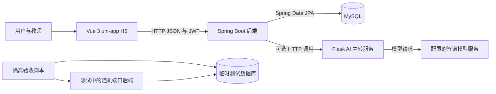
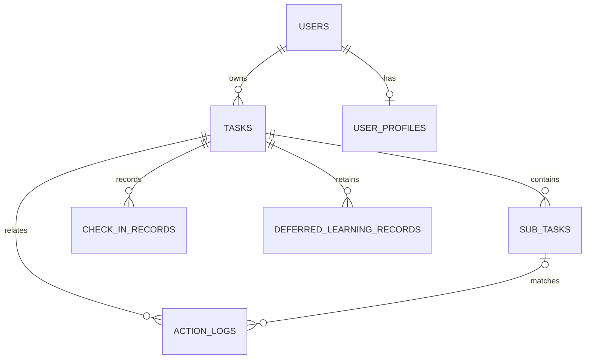
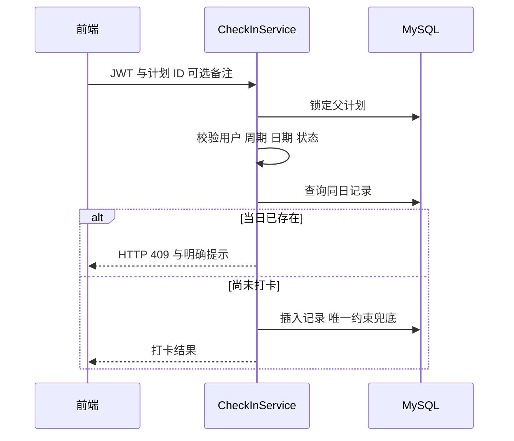

# LifeTrack AI 学习计划与智能打卡系统开发设计文档

编写日期：2026 年 10 月 27 日。课程：企业级 AI 软件设计与开发。对应选题：第 9 题学习计划与打卡系统。本文描述代码基准 `45f2a5a` 的实现；本次交付补充文档，不改变业务功能。

## 一 项目目标与适用范围

LifeTrack 在已有 AI 任务管理项目上改造，实现学习计划创建、周期执行、正式打卡、历史查询和统计反馈闭环。基础功能由 Java 后端与 MySQL 独立完成，Python AI 服务用于拆解学习步骤、分析自然语言学习记录和生成反馈。

本系统面向本地课程开发、演示与验收。当前认证使用明确 dev 环境下的开发账号或演示手机号，不提供生产短信认证。AI 判断依据用户自述，不等同于验证学习成果，也不提供心理诊断。

## 二 需求分析

用户需要创建有周期和目标天数的计划，按日记录坚持情况，查询历史，并区分学习进度与打卡目标是否达成。教师需要现场验证真实操作、持久化、重复打卡拒绝、非法日期和统计同步。

| 需求类别 | 已实现内容 | 验收方式 |
| --- | --- | --- |
| 计划管理 | 新增、列表、详情、编辑、删除、批量删除 | 页面操作与真实 HTTP 测试 |
| 周期与状态 | 起止日期、目标天数、五种状态及终态保护 | 合法与非法状态、周期测试 |
| 每日打卡 | 选计划一键打卡，备注可选；首条有效学习记录可自动打卡 | 唯一约束、并发与页面刷新 |
| 查询统计 | 按计划、日期、状态筛选；历史分页；连续天数与完成率 | 接口结果、直接 SQL、浏览器 |
| AI 增强 | 拆解预览与调整、步骤匹配、反馈、故障记录补分析 | 受控故障测试；真实模型单独验收 |
| 工程质量 | 用户隔离、统一异常、上海时区、迁移与测试库隔离 | HTTP、数据库约束及自动化证据 |

身份认证后的资源由当前用户隔离；本项目没有教师端、管理员业务后台或团队协作权限体系。

## 三 总体架构与技术选型

前端负责表单、交互和可视化；后端负责身份、归属、日期、状态和事务；数据库兜底唯一性、关联与数值约束。AI 是后端调用的外部能力，不直接操作数据库。保留单体后端，避免为课程闭环引入额外微服务或消息队列。

| 层次 | 采用技术 | 作用 |
| --- | --- | --- |
| 前端 | Vue 3、uni-app、Vite 5.2.8 | H5 页面与请求封装 |
| 后端 | Spring Boot 4.0.6、Spring Data JPA、Bean Validation | REST 接口、事务和校验 |
| 认证 | JWT 与登录拦截器 | 登录态和用户上下文 |
| 数据库 | MySQL、Flyway | 持久化、约束和版本演进 |
| AI 服务 | Python Flask、requests | Prompt 组织、模型调用及结果转换 |
| 测试 | JUnit、Mockito、真实 HTTP/MySQL、Node、Python unittest | 分层自动化验证 |

源码以 Java 17 为编译基线；最近证据实际使用 JDK 21.0.12.1、MySQL 8.0.45、Node 24.19.0、Python 3.12.10。环境版本是已验证记录，不是跨平台兼容性的保证。

## 四 模块职责与代码组织

| 模块 | 主要位置 | 职责 |
| --- | --- | --- |
| 登录 | `AuthController`、`DevelopmentAuthPolicy` | 开发能力查询、演示登录、环境约束 |
| 计划 | `TaskController`、`TaskService` | 周期、状态、子步骤、权重和删除 |
| 正式打卡 | `CheckInController`、`CheckInService` | 一日一次、历史、连续天数与达成率 |
| 学习记录 | `ActionController`、`ActionServiceImpl` | AI 匹配、实际贡献、自动打卡与撤销 |
| 故障记录 | `DeferredLearningRecordService` | 原内容、时长、发生时间保存及补分析 |
| 看板反馈 | `DashboardServiceImpl`、`FeedbackServiceImpl` | 按统一范围计算统计与组织报告输入 |
| 基础设施 | `config`、`exception`、`repository` | JWT、统一异常、事务、迁移和持久化 |
| 页面 | `frontend/src/pages` | 登录、首页、计划、详情、记录、个人页 |

请求从 Controller 的 DTO 校验进入 Service，Service 执行业务与归属校验，Repository 访问数据库。实体中的标量 ID 并不替代数据库外键；外键和 CHECK 由冻结总脚本建立。

## 五 数据模型与数据字典

ER 图表示业务关系；旧学习日志允许没有计划或步骤，具体可空性、索引和约束以 [初始化 SQL](../../backend/sql/init_db.sql) 为准。数据库中可能保留旧项目的其他表，但以下七张表构成当前主要闭环。

### 用户与个人资料

`users`：`id BIGINT` 为主键；`username VARCHAR(50)` 唯一；`password VARCHAR(100)` 为保留字段，演示账号使用禁用密码登录的占位值，当前没有账号密码登录流程；`phone VARCHAR(20)` 唯一；`openid VARCHAR(100)` 仅兼容历史数据，不再用于登录；另有 `avatar`、`created_at`、`updated_at`。

`user_profiles`：`id` 主键；`user_id` 唯一并关联用户；`energy_level`、`current_anxiety_level` 保存既有个人状态；`daily_quote VARCHAR(500)`、`interest_tags JSON`、`updated_at` 保存既有画像信息。焦虑值入口在个人页，本轮不扩展其功能。

### 学习计划与子步骤

| 表 | 字段 | 类型与含义 |
| --- | --- | --- |
| tasks | id、user_id | BIGINT 主键与所属用户 |
| tasks | title、category | VARCHAR(100) 标题；学习、娱乐、休息、运动、琐事分类 |
| tasks | start_date、end_date、target_days | DATE 起止日期；INT 目标打卡天数 |
| tasks | status | INT 状态码，映射见状态设计 |
| tasks | total_progress、version | DECIMAL(7,4) 学习进度比例；BIGINT 乐观锁版本 |
| tasks | ai_suggestion、created_at、updated_at | TEXT 建议与创建、更新时间 |
| sub_tasks | id、task_id | BIGINT 主键与所属计划 |
| sub_tasks | content、weight | VARCHAR(255) 步骤；DECIMAL(10,4) 权重比例 |
| sub_tasks | current_progress、is_completed、order_num | DECIMAL(7,4) 进度比例；INT 完成标志与顺序 |

计划周期必须开始不晚于结束；目标天数在 1 到包含首尾日期的周期天数之间。子步骤创建为 1 到 100 项，内容不为空，创建权重为正并归一化。步骤增减或调整权重时按比例重新分配，原有进度不会因新增步骤被直接清零。

### 正式打卡与学习记录

| 表 | 字段 | 类型与含义 |
| --- | --- | --- |
| check_in_records | id、user_id、task_id | BIGINT 主键、用户及计划 |
| check_in_records | check_in_date | DATE 上海业务日期 |
| check_in_records | content、duration_minutes、mood | VARCHAR(500) 备注、INT 时长、VARCHAR(20) 心情 |
| check_in_records | automatic、created_at | BIT 自动标志，旧记录可空；创建时间 |
| action_logs | id、user_id、task_id、sub_task_id | BIGINT 标识和可空计划、步骤关联 |
| action_logs | category、raw_input | 分类及 TEXT 原始自然语言 |
| action_logs | contribution、duration_minutes | DECIMAL(7,4) 实际进度增量与分配时长 |
| action_logs | ai_analysis、created_at | VARCHAR(255) 分析与学习发生时间 |
| deferred_learning_records | id、user_id、task_id | BIGINT 标识与归属 |
| deferred_learning_records | content、duration_minutes、recorded_at | VARCHAR(500) 内容、INT 时长及原始发生时间 |
| deferred_learning_records | status、last_analysis | PENDING、APPLIED、UNMATCHED；TEXT 最近分析 |

正式打卡有 `(user_id, task_id, check_in_date)` 唯一约束。打卡和待分析记录通过复合外键约束计划属于同一用户。进度、状态、周期、时长由 CHECK 或后端校验兜底。学习记录保存实际增量，撤销按实际增量回退，避免用模型原始估计值重复扣减。

手动一键打卡默认空备注、时长为 0，不产生 AI 学习日志。学习日志可在同一天追加多条；正式打卡仍只保留一天一次。故障记录保存的时间是原始学习时间，补分析不挪到重试当天。

## 六 状态与统计口径

| 状态 | 数据库存储 | 主要规则 |
| --- | --- | --- |
| IN_PROGRESS | 0 | 有效周期内执行，可打卡和更新学习步骤 |
| COMPLETED | 1 | 人工确认或有效周期内加权进度达到 100% 后完成，不能回退 |
| NOT_STARTED | 2 | 周期尚未开始，可修改计划，不能打卡 |
| CANCELLED | 3 | 历史保留，退出看板统计，不能重新打开 |
| EXPIRED | 4 | 已过有效期，不再正式打卡，不能改日期重新开始 |

启动与定时任务维护日期状态，页面查询只读。已完成或已取消计划禁止增删改步骤、撤销学习记录、补分析，以及修改周期和打卡目标；标题等允许的元信息由编辑接口校验。过期计划的已有故障记录可在原发生日期符合周期时补分析，不等同于新增过期打卡。

状态和学习进度分开保存：人工确认完成不会伪造子步骤进度或重写历史。推荐演示通过完成所有子步骤自动进入完成状态，以直观展示 100% 学习进度与不足 100% 打卡率可以同时存在。

| 指标 | 计算方法 |
| --- | --- |
| 单计划学习进度 | 子步骤权重 × 子步骤进度之和，界面换算为百分比 |
| 单计划打卡目标达成率 | 真实打卡日数 ÷ targetDays × 100%，上限 100% |
| 首页计划完成率 | 已完成计划数 ÷ 全部未取消计划数，空集合为 0 |
| 全局打卡天数 | 未取消计划的真实打卡日期按 Asia/Shanghai 自然日去重 |
| 当前连续天数 | 最近打卡日为今天或昨天时向前连续计数，否则为 0 |
| 最长连续天数 | 按有序真实日期计算最长相邻日期序列 |
| 最近七天 | 包含今天的七个业务日期，全局每日是否打卡按 0 或 1 展示 |

同一天多个计划只增加一个全局打卡日。未开始、进行中、过期计划仍进入首页完成率分母；取消计划的历史可以查询，但不进入看板打卡、时长、进度、趋势、完成率和 AI 反馈的分析范围。AI 分析不使用无计划关联的旧日志冒充当前计划成果。

## 七 关键业务流程

### 计划创建与周期编辑

手动创建先校验周期、目标、分类和步骤，再在事务内保存计划和步骤。AI 拆解先预览和调整，用户确认后才保存；预览失败不产生假计划。

编辑周期时锁定计划，重新计算新周期外的正式打卡 ID。只有请求同时带删除确认以及与当前待删除集合完全一致的 ID，才在同一事务中修改周期和删除越界打卡。未确认或确认已失效时返回 409；学习日志不会因此被当作正式打卡一起清空。

### 正式每日打卡

前端默认只打今天；接口允许当前仍在执行的计划补录周期内非未来日期，不能对已结束计划新增打卡。当前实现没有限制补录次数以外的“最近几天”窗口，这是现有接口政策，应在答辩中如实说明。

### AI 学习记录与故障补分析

先读取候选计划和步骤快照，在不持有写事务及计划行锁时请求 AI；分析返回后，只按 ID 升序锁定命中计划，校验用户、版本、周期、状态及步骤是否变化。发现变化返回 409，要求重新提交，避免用旧结果覆盖新进度。

模型只提出匹配和贡献建议。后端验证有效步骤、独立原文证据和增量边界，保存实际贡献；普通估计最多到 95%，达到 100% 需要用户原文中的具体完成证据或手动确认。多步骤分摊时长，避免一条输入的时长被每个步骤重复计算。

首条有效学习记录与自动打卡在同一写事务内完成。AI 不可用时不伪造匹配、进度或打卡；用户可单独保存待分析记录。补分析先无锁请求 AI，再按父计划、故障记录顺序加锁，检查是否已应用，原子更新状态与贡献，失败保持可重试。

### 删除与取消

取消只改变状态并保留全部历史；删除会清理日志、步骤、正式打卡、故障记录和计划。删除步骤时数据库将历史日志的步骤关联置空，保留原始学习记录。批量删除限制数量、验证归属并采用固定加锁顺序，失败回滚。

## 八 接口设计

基础路径为 `/api/v1`，受保护接口使用 `Authorization: Bearer <token>`。成功和异常均采用 `code/message/data`，HTTP 状态与业务码一致。

| 方法与路径 | 用途 |
| --- | --- |
| GET /auth/options | 查询演示登录能力 |
| POST /auth/login/dev、/auth/login/phone | 开发账号或演示手机号登录 |
| POST /tasks/manual | 手动创建计划和步骤 |
| POST /tasks/deconstruct/preview、/tasks/deconstruct | AI 拆解预览与创建 |
| GET /tasks | 按状态及周期交集筛选 |
| GET、PUT、DELETE /tasks/{id} | 详情、编辑、删除 |
| POST /tasks/batch-delete | 批量删除 |
| GET、POST /tasks/{id}/subtasks | 查询、新增子步骤 |
| PUT、DELETE /tasks/subtasks/{id} | 编辑、删除步骤 |
| PUT /tasks/subtasks/{id}/complete | 手动完成步骤 |
| POST、GET /check-ins | 正式打卡与计划、日期历史查询 |
| GET /check-ins/tasks/{id}/stats | 单计划打卡统计 |
| POST /actions/sync | 分析并保存学习记录 |
| GET /actions/history、DELETE /actions/{id} | 学习记录分页、撤销 |
| POST、GET /actions/deferred | 保存、查询故障学习记录 |
| POST /actions/deferred/{id}/retry | 对原始记录补分析 |
| GET /dashboard/stats、/dashboard/tasks/{id}/contributions | 看板与步骤贡献 |

字段的权威定义是后端 DTO；实时接口清单可查询 `/v3/api-docs`。学习历史使用 page/size 与稳定的时间、ID 倒序；界面每页 20 条，翻页替换内容。打卡历史和计划列表保持当前筛选接口，没有宣称全部列表都已分页。

## 九 异常 安全与并发设计

400 表示参数、周期或状态不合法；401 表示缺失或无效登录态；403 表示越权或演示认证不可用；404 表示资源或路由不存在；409 表示重复、确认失效或并发冲突；503 用于不可用的 AI 创建或预览；未知异常返回通用 500，不回传内部错误正文。

演示认证必须同时满足唯一激活环境为 dev 和对应开关开启，dev 对连接同一后端的全部用户生效。微信登录已删除。手机号、验证码、Token 和模型密钥不得写入业务日志或交付材料；保留字段不表示存在对应登录功能。

核心写操作共用父计划悲观锁，Task 版本字段保护过时实体写入；写事务采用 READ_COMMITTED。数据库唯一约束防止并发重复打卡，外键防止不属于同一用户的计划关联。此处保护的是服务端并发更新，不宣称前端两个旧编辑表单已具备完整版本协商协议。

## 十 数据库初始化与部署

首次从空 MySQL 执行 [init_db.sql](../../backend/sql/init_db.sql)，创建数据库、表和约束；确认完成后一次性允许 Flyway 登记基线 1，成功后移除接管开关。以后新增结构迁移从 V2 开始，Hibernate 仅 validate，禁止依赖自动改表。

正常启动使用 DB_URL 指定的日常库，反复启停不会换库。`verify-course.ps1` 才创建并清理临时测试库，集成测试拒绝默认连接日常库。完整新机器步骤见[提交清单与使用说明](提交清单与使用说明.md)。

后端端口 8081，前端 5173，可选 AI 服务 5000。Java 连接 AI 的连接超时为 2 秒，读取超时默认 40 秒且可配置；Python 模型读取超时默认 30 秒。所有业务日期使用 Asia/Shanghai，实体自动时间显式采用该时区。

## 十一 验证结果与限制

最近完整证据运行于 2026 年 10 月 26 日，记录对应代码工作树的源码指纹：后端 135 项、AI 单元测试 10 项、验收工具测试 5 项通过，前端声明、带桩逻辑、H5 构建与依赖检查通过。135 项分为 113 项单元、12 项真实 HTTP/MySQL、8 项真实数据库事务、1 项上下文、1 项前端真实 HTTP 契约；数量不等于覆盖率百分比。

浏览器记录包含创建、编辑刷新、空备注打卡、刷新已打卡状态、禁用重复按钮、历史分页及 390px 窄屏。未宣称微信小程序、Android 原生端或所有浏览器已验证。最近完整回归未重跑真实模型质量脚本；模型结果和耗时具有外部依赖，需单独记录。

证据入口：[验收证据索引](../verification/README.md)。本次仅编写交付文档，不将此前测试冒充 10 月 27 日重新执行。

## 十二 后续改进

提交前优先在另一台干净机器按说明启动，补齐作者与实际分工信息，并完成视频。更长期可收紧人工完成与步骤进度的一致性政策、明确补录窗口、完善全部列表分页和跨端测试；真实短信或生产部署需另行设计。焦虑值功能按当前决定暂不扩展。

开发中 AI 的使用、采纳与验证见[AI 辅助开发记录](AI辅助开发记录.md)；需求到代码和测试的对应关系见[需求与验收对照表](需求与验收对照表.md)。
