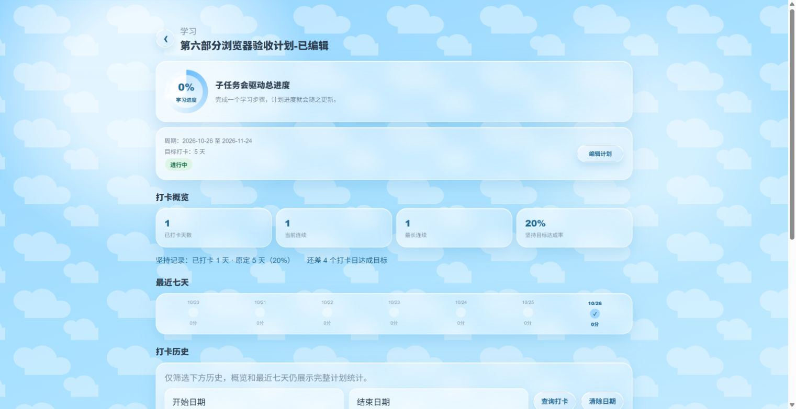

# 2026-10-26 浏览器实际验收

方式：通过已连接 Chrome 的真实页面点击、输入、刷新和翻页完成；不是读取源码代替点击，也不是完整自动重放套件。页面为本机 H5 与真实 Java/MySQL，使用已有 dev_admin 账号。

本轮专用临时计划 ID 201，创建名为“第六部分浏览器验收临时计划”，编辑后为“第六部分浏览器验收计划-已编辑”。只修改该临时计划，未修改已有学习记录。

| 操作 | 观察到的结果 |
| --- | --- |
| 点击开发登录 | 进入真实看板 |
| 空表单点击保存 | 可访问性状态出现“先写一个任务名称”，表单未关闭；瞬时提示没有留在截图中，不能仅以截图 01 证明提示文本 |
| 手动填写标题与一个步骤并保存 | 列表出现新计划，点击进入 ID 201 的详情 |
| 编辑标题、目标改为 5 天并保存、刷新 | 详情显示修改后的标题和目标 5 天 |
| 在记录页选择该计划，不填写备注，点击今日打卡 | 显示“今日已打卡” |
| 刷新并重新选择该计划 | 仍显示“今日已打卡”，按钮 DOM 的 disabled 为 true |
| 学习历史点击下一页、上一页 | 22 条真实已有记录的页码在 1/2 与 2/2 间切换；未新增或撤销这些记录 |
| 点击“查看该计划打卡历史” | 详情显示 1 天、当前连续 1、最长连续 1、目标 5 天达成率 20%；学习进度仍为 0%，时长为 0 |
| 临时设置 390×844 视口 | 详情按窄屏布局，读取到 viewport 390、documentWidth 375，无横向页面溢出；截图后恢复原视口 |
| 直接 SQL 核对并清理 | 正式打卡恰好一条、时长 0；删除本次临时计划后查询返回 HTTP/code 404，见 database-check.json |

截图：

- [空表单状态](01-empty-plan.png)：证明所测表单，不包含瞬时提示文本。
- [今日已打卡](02-today-checked.png)：证明实际打卡后的界面状态。
- [刷新后的详情与统计](03-persisted-detail.png)。
- [390px 窄屏详情](04-mobile-detail.png)。

本轮未验证微信小程序、Android 原生端、全部浏览器/设备组合；未把模型报告质量算作本项通过条件。日期选择器等未在本轮实际操作的控件，也不由上述结果推断为已覆盖。
